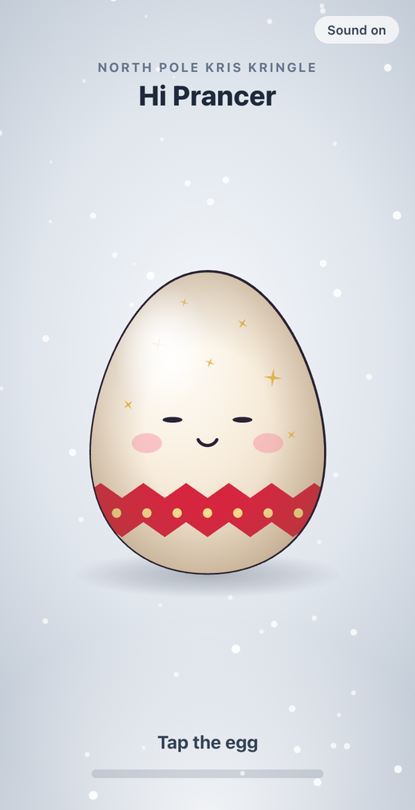
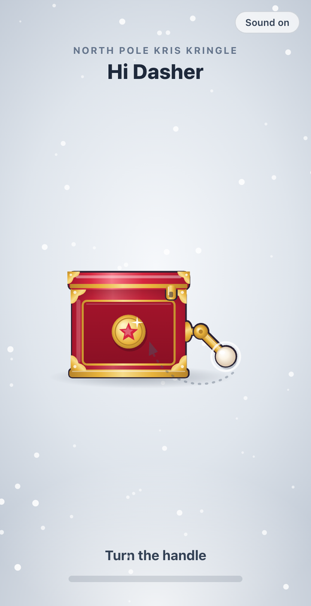
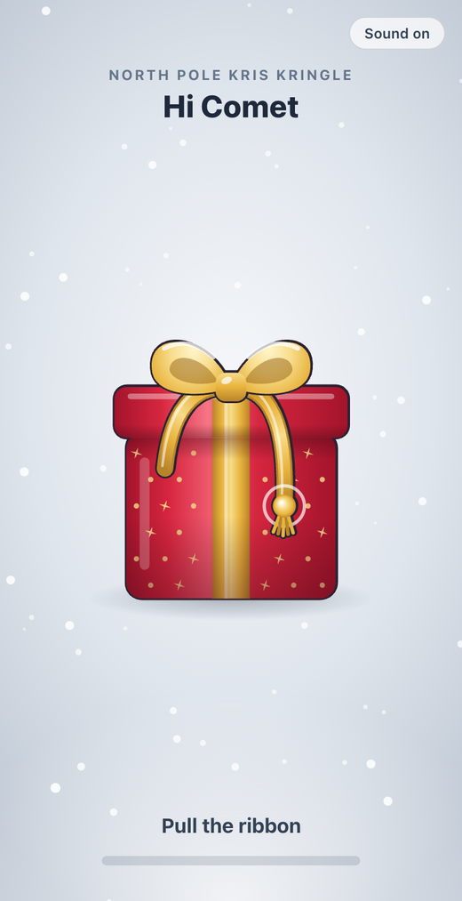
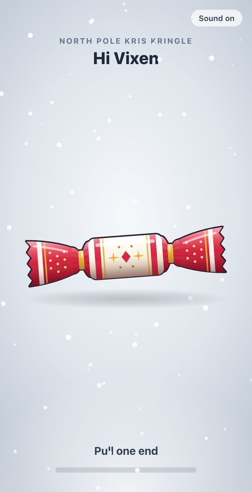
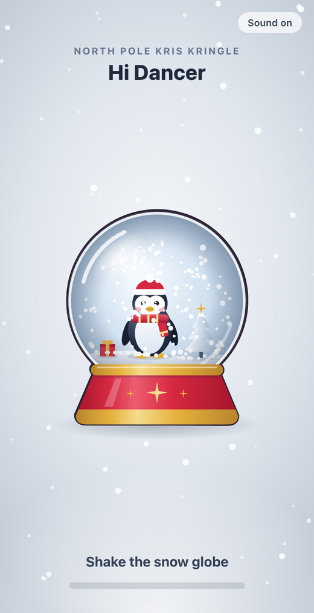
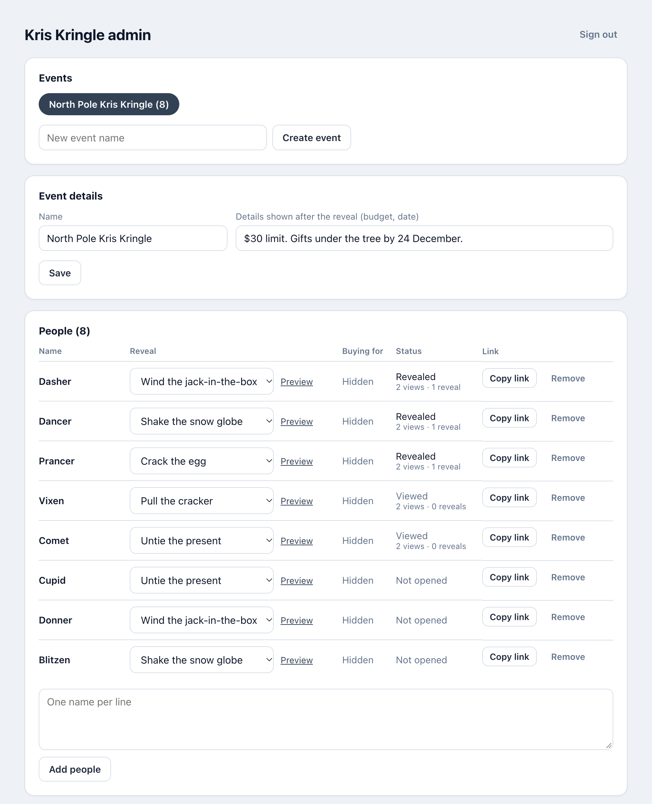
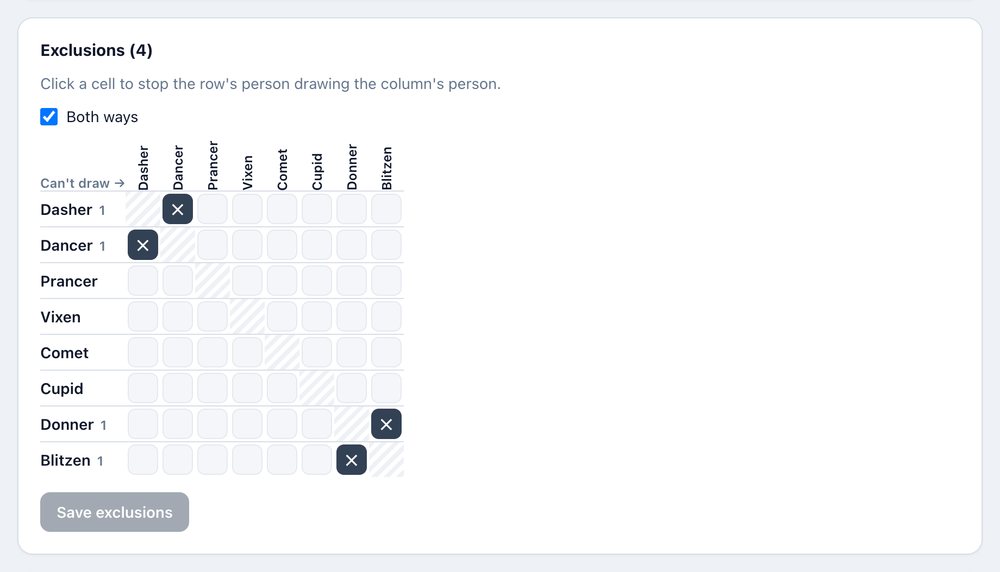

# Kris Kringle

Secret-gift draw. Each person gets a private link and has to open an object to see who they are
buying for.

# [kris-kringle.nf-s.workers.dev](https://kris-kringle.nf-s.workers.dev/preview/egg)

## Reveals

Each person is given one of five objects. All of them work by touch, and on a phone by moving the
phone itself.

  
  
  
  
  

| Reveal          | On screen       | Moving the phone | Sample                                                          |
| --------------- | --------------- | ---------------- | --------------------------------------------------------------- |
| Egg             | Tap             | Jolt             | [Try it](https://kris-kringle.nf-s.workers.dev/preview/egg)     |
| Jack-in-the-box | Turn the handle | Twist            | [Try it](https://kris-kringle.nf-s.workers.dev/preview/jack)    |
| Present         | Pull the ribbon | Flick            | [Try it](https://kris-kringle.nf-s.workers.dev/preview/present) |
| Cracker         | Pull one end    | Flick            | [Try it](https://kris-kringle.nf-s.workers.dev/preview/cracker) |
| Snow globe      | Shake           | Shake            | [Try it](https://kris-kringle.nf-s.workers.dev/preview/globe)   |

The "Try it" links use sample data. Phones that report movement show a "Motion on / Motion off"
button; on an iPhone it starts off and turning it on brings up the system's permission prompt.

## Running a draw

The admin page is at `/` and is password protected.

1. Create an event and add people, one name per line.
2. Pick each person's reveal.
3. Mark who must not draw whom.
4. Draw names. Assignments stay hidden unless you ask to see them.
5. Copy each person's link and send it to them. Links look like `lilac-magpie-dasher`: two random
   words, then the person's first name.
6. Watch who has viewed and opened their link.

- Adding or removing people clears the draw. Redrawing keeps the same links. Saving exclusions
  only clears the draw if it gives someone a person they are now excluded from.
- The draw prefers one loop through the whole group. If exclusions rule that out it falls back to
  smaller loops, and reports an error if no draw fits.
- A client that requests 20 unknown links within 15 minutes is blocked for the rest of that
  window, so links cannot be guessed by brute force.
- An event can have illustrated characters that stand round the object and react as it opens. They
  are imported from a folder in the admin (`characters.json` plus the images it names) into one
  library shared by every event. Artwork is stored with the app's data, not in this repository.

## Routes

| Path                | Purpose                                                                   |
| ------------------- | ------------------------------------------------------------------------- |
| `/`                 | Admin                                                                     |
| `/r/<link>`         | A person's private reveal                                                 |
| `/r/<link>?preview` | The same page without recording a view or reveal                          |
| `/preview/<kind>`   | A reveal with sample data: `egg`, `jack`, `present`, `cracker` or `globe` |

## Development

Runs on Cloudflare Workers: a Hono API, one Durable Object for storage, and static assets for the
front end.

| Command             | Purpose                                                                      |
| ------------------- | ---------------------------------------------------------------------------- |
| `npm run dev`       | Local dev server (Vite + workerd)                                            |
| `npm test`          | Unit tests: draw, API, phone motion, cast state and placement, sprite import |
| `npm run typecheck` | TypeScript, front end and Worker                                             |
| `npm run format`    | Prettier                                                                     |
| `npm run deploy`    | Build and deploy to Cloudflare                                               |

The Worker reads the admin password from the `ADMIN_PASSWORD` secret.

- Local: `.dev.vars` (`ADMIN_PASSWORD=...`, not committed).
- Production: `npx wrangler secret put ADMIN_PASSWORD`.

### Layout

- `worker/` — API, draw logic, Durable Object, link word lists, rate limit and character library.
- `shared/schema.ts` — Zod schemas shared by the API and the front end.
- `src/admin/` — admin page.
- `src/reveal/` — reveal page. `kinds/` has one file per reveal.
- `src/characters/` — builds and draws character sprite sheets.

### Storage

One Durable Object holds every event. The original event is stored under `event` (shown as event
id `main`) and cannot be deleted; other events are stored as `event:<id>`. The character library is
one list under `characters`, with each sprite sheet under `character-image:<id>`.

## Made with AI

The code and documentation were generated almost entirely by AI coding agents, directed by the
author. They can contain errors.

## Licence

Original work in this repository is dedicated to the public domain under [CC0 1.0](LICENSE),
without warranty. It contains no third-party artwork, fonts or data. Two things keep their own
licences:

- `worker-configuration.d.ts` is generated by Wrangler and contains Cloudflare and Microsoft type
  definitions under the Apache License 2.0.
- npm dependencies, including [Hono](https://hono.dev/) and [Zod](https://zod.dev/) (both MIT).
